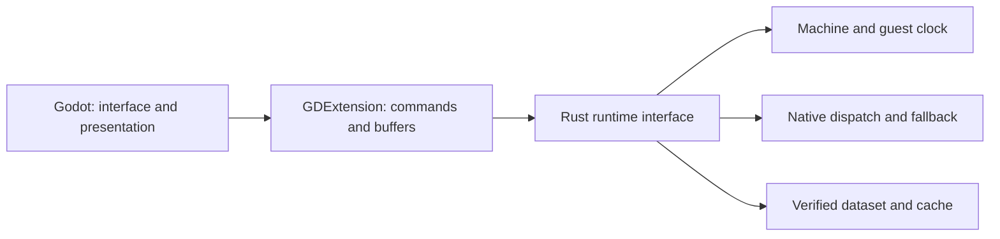

# Assessment and TODO — Godot 4 frontend

Updated October 26, 2026. **Planning only; development deferred.** The priority
remains completing ROM extraction and consumption of the resulting data in the
runtime. This document does not authorize builds, installations, refactoring or
prototypes. The initial code draft was removed at the user's request.

## Assessment

Godot is a reasonable candidate for the window, menus, controller navigation,
layout and presentation. Rust should continue to manage the CPU, memory, guest
clock, recompilation, extracted data and saves. Changing the frontend does not
require rewriting the game as Godot scenes or reimporting all extracted assets
through a second decoder.

The expected benefit is easier interface development. A speed or latency
advantage over the current frontend has not been demonstrated. Costs to assess
include frame transfer, audio synchronization, input handling and distribution
of the engine with the extension.

The recommendation is to **finish the ROM work first, then assess a limited
trial**, without committing to a complete migration now.

## Current code

- [Machine](../../crates/gba-core/src/machine.rs) is already a usable library
  interface for interpreted execution and machine state.
- [recomp-core](../../crates/recomp-core/src/lib.rs) exposes analysis and
  compilation; this does not expose the entire game runtime.
- Mixed native/interpreter dispatch is still a private function in
  [main.rs](../../crates/recomp/src/main.rs), called by the loop in
  [play.rs](../../crates/recomp/src/play.rs). The latter also coordinates input,
  audio, presentation, pause and cartridge memory writes.
- Dataset preparation and loading live in the application module
  [rom_data.rs](../../crates/recomp/src/rom_data.rs). A future frontend must
  reuse its identity, checks and immutable owners.
- [Core snapshots](../../crates/gba-core/src/save_state.rs) differ from
  [desktop slots](../../crates/recomp/src/save_state.rs), which add previews,
  atomic writes and Undo. Connecting Machine alone does not automatically bring
  those features to Godot.

An interpreter trial is therefore possible without redoing the native
architecture. A frontend that also preserves recompilation and all desktop
features first needs a reusable runtime boundary. This is the main architectural
requirement, not a GDExtension limitation.

## Prerequisites and order

### GD-00 — Preliminary assessment

- [x] Identify the reusable core and parts still tied to the executable.
- [x] Distinguish a connection trial from a complete frontend replacement.
- [x] Record the deferral and remove the implementation skeleton already started.

### GD-01 — Complete ROM work before Godot development

- [ ] Complete the agreed EUR scope for inventory, extraction/decoding,
  preparation, direct consumption and verification: [ROM_DATA_TODO](ROM_DATA_TODO.md).
- [ ] Establish a reproducible baseline: code revision, ROM identity,
  dataset manifest/version and accepted functional evidence.
- [ ] Declare resources or languages still open and remaining ROM dependencies;
  the map percentage alone is not a completion criterion.
- [ ] Explicitly select Godot work in the future. Completion of a ROM increment
  must not start this TODO automatically.

Mods, complete removal of the `.gba`, completion of every DS case, Android and
USA parity are not technical prerequisites for an initial EUR trial. Including
any of them in the preliminary phase requires a scope decision; do not add them
automatically as blockers.

### GD-02 — Define the runtime interface

- [ ] Decide what the first prototype must demonstrate: communication with
  Machine or native execution as well. An interpreter-only prototype does not
  support conclusions about native-path performance.
- [ ] Define creation/destruction, ROM/dataset loading, advancing one complete
  frame, input, video, audio, pause, reset and errors.
- [ ] To include native execution, plan a shared headless library that reuses
  existing dispatch, cache and fallback. Avoid a second dispatcher copy
  maintained separately in the plugin.
- [ ] Treat that separation as distinct work after the ROM work. Do not replace
  the normal executable during the study; any existing frontend refactor needs
  its own phase with equivalence verification.

Proposed responsibilities, not yet implemented:

### GD-03 — Agree on contracts before the prototype

- [ ] **Time and input:** Rust retains the guest clock. Godot refresh must not
  turn an identical input sequence into different execution. Define pause, loss
  of focus and button release.
- [ ] **Video:** choose a classic 240×160 frame for the first trial. Inventory
  widescreen, native HUD/UI and current filters separately: a classic texture
  does not demonstrate their parity. Establish buffer format, size and lifetime
  without letting Godot read invalidated Rust pointers.
- [ ] **Audio:** define effective sample rate, channels, bounded queue,
  synchronization, pause and flushing after Load/reset. Assess sending blocks
  through GDExtension to AudioStreamGenerator.
- [ ] **Data:** keep the manifest, hashes, dependencies and typed resource
  reading in Rust; no second extraction or independent interpretation in
  GDScript. Native caches remain tied to the correct ROM and ABI.
- [ ] **Persistence:** reuse snapshot and SRAM formats and validation. Define
  restoration of queues and native context, previews and Undo; initially work
  only with copies and prototype directories.
- [ ] **Lifecycle:** assign an owner to the runtime and buffers; define queue
  and thread shutdown and library loading/unloading. Do not introduce extension
  hot reload in the first trial.

### GD-04 — Prepare isolation when development is selected

- [ ] Choose a supported, versioned Godot/godot-rust pair; recheck compatibility
  when development starts.
- [ ] Use a separate project and Cargo workspace, with their own lockfile and
  build directory; freeze the runtime at an agreed revision.
- [ ] Do not use production or extraction targets, caches, save paths or Wine
  prefixes. Exclude game data and generated binaries from Git.
- [ ] Prepare a reproducible Windows procedure. Docker is an option for build
  dependencies; assess distribution of the Godot project separately. Do not
  change the normal extraction or packaging commands.

### GD-05 — Future minimal trial and decision criterion

- [ ] Verify real GDExtension loading and clean startup/shutdown.
- [ ] Try ROM, input, classic frame, audio, pause and snapshot loading in a
  separate working directory.
- [ ] Compare identical sequences between the headless runtime and bridge:
  state, guest clock, images and audio; check errors without losing the already
  loaded game. Reuse appropriate accepted ordinary checkpoints.
- [ ] If native execution is planned, also verify cache, fallback, Load/reset and
  dataset, beyond simply starting the interpreter core.
- [ ] Only after these trials decide whether the interface benefit justifies
  full integration, packaging and porting advanced features.

Full widescreen/HUD, physical controllers, Linux and other platforms, complete
backup/Undo integration and performance measurements are later adoption
criteria. They remain explicit and do not become passed checks merely by
connecting the library. No benchmark is planned now.

## Technical references

- [godot-rust compatibility and API/runtime versions](https://godot-rust.github.io/book/toolchain/compatibility.html).
- [AudioStreamGenerator](https://docs.godotengine.org/en/stable/classes/class_audiostreamgenerator.html): stream rate and audio submission from compiled code.
- [Thread-safe APIs](https://docs.godotengine.org/en/stable/tutorials/performance/thread_safe_apis.html): Godot scene tree and resource handling.
